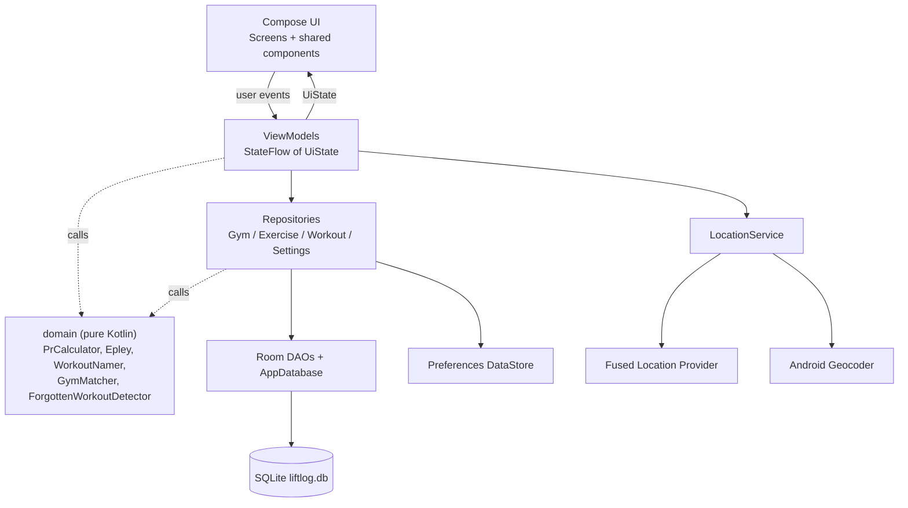
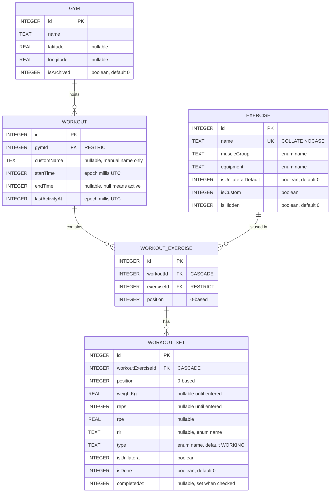
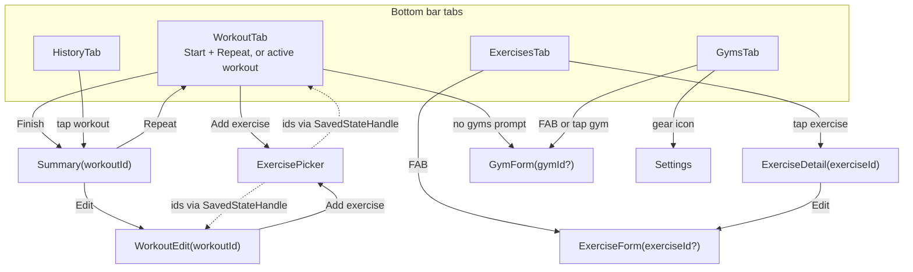
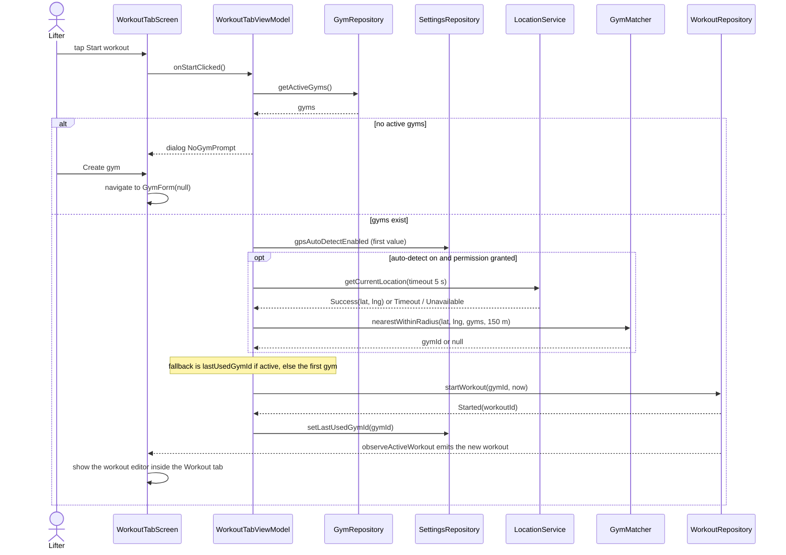
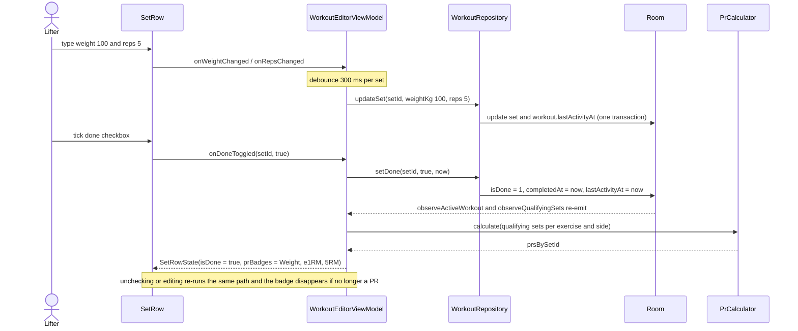
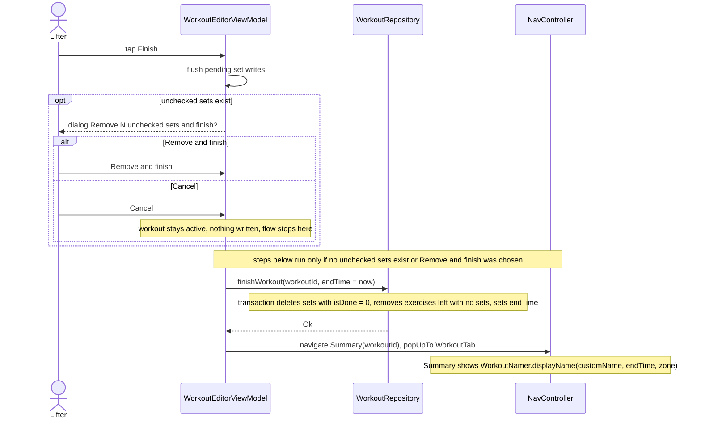
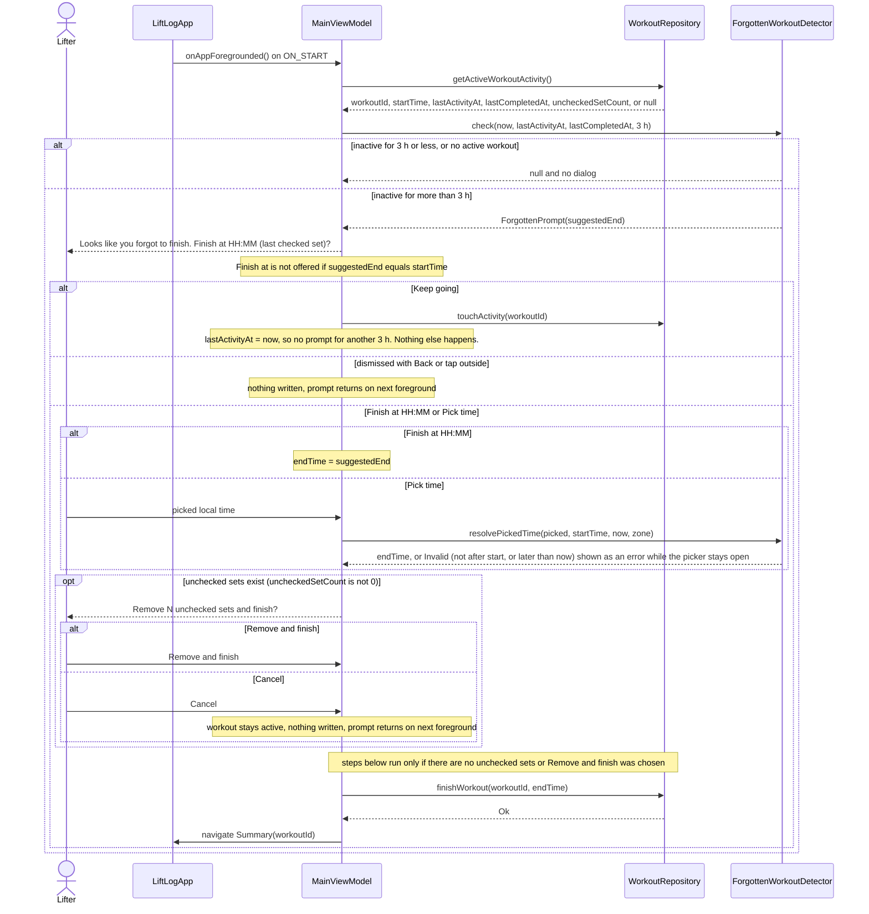
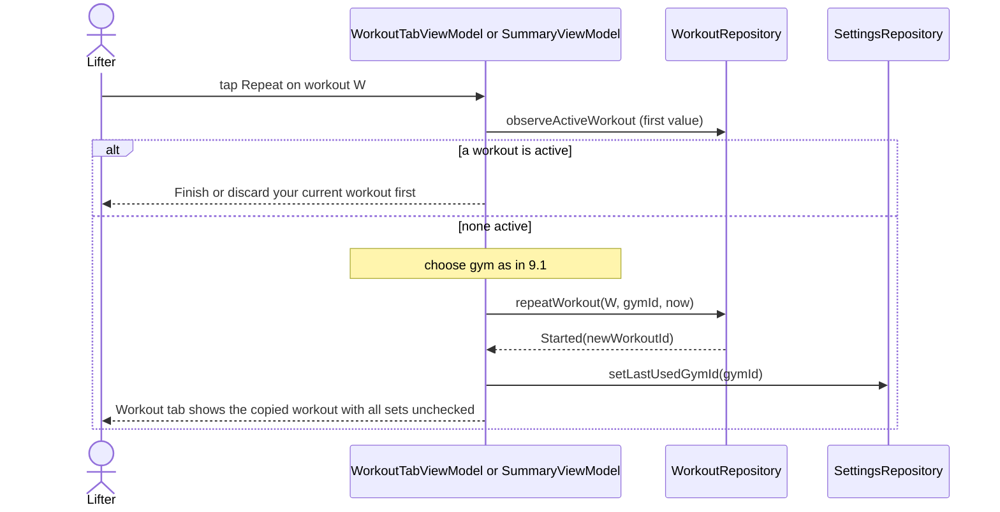

# LiftLog – Design Document

This document describes **how** LiftLog is built: architecture, package structure, data model, domain rules, the repository contract, settings, navigation, screens, key flows, testing and traceability. **What** the app does, and the acceptance criteria, are in [SPEC.md](SPEC.md). References like "SPEC 4.10" point to feature IDs in SPEC.md §3.

The document has no implementation code. Signatures appear only as tables and prose, and diagrams are Mermaid.

The only item still open is SPEC §6 question 1 (the seed list); see [Open questions](#open-questions) at the end.

---

## 1. Overview and architecture

LiftLog is a single-activity, fully offline Android app (Kotlin, Jetpack Compose, Material 3). It uses **MVVM with unidirectional data flow**:

- **Compose UI** renders an immutable `UiState` and sends user events to its ViewModel. It holds no business logic.
- **ViewModels** expose one `StateFlow<UiState>` each. They combine repository `Flow`s, call pure domain functions (PRs, names, matching) and call repository `suspend` writes. One-off effects such as navigation are sent through a `Channel`-backed `Flow` of events.
- **Repositories** are the only way to reach data. They wrap the Room DAOs, the Preferences DataStore and transactions. Room is the single source of truth: the UI state is always derived from database `Flow`s, never from an in-memory copy (SPEC 4.9).
- **domain/** is pure Kotlin with no Android dependencies. Repositories and ViewModels both use it, and it is fully unit-testable.
- **LocationService** wraps the Fused Location Provider and the Android `Geocoder` behind an interface, so ViewModels can be tested with a fake.

There is no LiveData and there are no per-action UseCase classes. Dependency injection is Hilt. A `java.time.Clock` is injected wherever "now" is needed, so time-based rules are testable.

**Threading.** DAO `suspend` functions and `Flow`s run on Room's own executors. Heavier domain work, mainly PR calculation over the set history, runs on `Dispatchers.Default` with `flowOn`. Blocking `Geocoder` calls run on `Dispatchers.IO`.

---

## 2. Package structure

There is one Gradle module, `app`, with namespace and applicationId `app.liftlog`.

| Package | Contents | Depends on |
|---|---|---|
| `app.liftlog` | `LiftLogApplication` (`@HiltAndroidApp`), `MainActivity` (`@AndroidEntryPoint`, single activity) | everything |
| `app.liftlog.data.db` | `AppDatabase`, entities, DAOs, `Converters` (TypeConverters), Room read models (relations, query rows) | `domain` |
| `app.liftlog.data.db.seed` | `SeedExercises` (the seed list) and the `RoomDatabase.Callback` that inserts it in `onCreate` | `domain` |
| `app.liftlog.data.settings` | Preferences DataStore keys and the `SettingsRepository` implementation | `domain` |
| `app.liftlog.data.repository` | `GymRepository`, `ExerciseRepository`, `WorkoutRepository` | `data.db`, `domain` |
| `app.liftlog.data.location` | `LocationService` interface + `AndroidLocationService` (Fused Location + Geocoder) | Play Services Location |
| `app.liftlog.domain` | `Epley`, `PrCalculator`, `WorkoutNamer`, `GymMatcher`, `ForgottenWorkoutDetector`, `Constants` | nothing (pure Kotlin) |
| `app.liftlog.domain.model` | Enums `SetType`, `Rir`, `Equipment`, `MuscleGroup`, `ThemeMode`, `PrType`; domain input/output types such as `QualifyingSet`, `PrResult`, `GymLocation` | nothing |
| `app.liftlog.ui` | `LiftLogApp` (root scaffold with bottom bar and `NavHost`), `MainViewModel` (theme + forgotten-workout check) | `data`, `domain` |
| `app.liftlog.ui.theme` | `LiftLogTheme` with light and dark Material 3 color schemes, typography | – |
| `app.liftlog.ui.navigation` | `@Serializable` route types, nav graph, bottom bar items | – |
| `app.liftlog.ui.components` | Shared composables: `SetRow`, `GymPicker` (bottom sheet), `PrBadge`, `RpePicker`, `RirPicker`, `SetTypeSelector`, `ConfirmDialog`, `EmptyState` | `domain.model` |
| `app.liftlog.ui.workout` | `WorkoutTabScreen` + `WorkoutTabViewModel` (Start / Repeat list), `WorkoutEditorScreen` + `WorkoutEditorViewModel` (active and edit mode), UiStates | |
| `app.liftlog.ui.summary` | `SummaryScreen`, `SummaryViewModel`, `SummaryUiState` | |
| `app.liftlog.ui.history` | `HistoryScreen`, `HistoryViewModel`, `HistoryUiState` | |
| `app.liftlog.ui.exercises` | `ExerciseListScreen` (library and picker mode), `ExerciseListViewModel`, `ExerciseFormScreen`, `ExerciseFormViewModel`, UiStates | |
| `app.liftlog.ui.exercisedetail` | `ExerciseDetailScreen`, `ExerciseDetailViewModel`, `ExerciseDetailUiState` | |
| `app.liftlog.ui.gyms` | `GymListScreen`, `GymListViewModel`, `GymFormScreen`, `GymFormViewModel`, UiStates | |
| `app.liftlog.ui.settings` | `SettingsScreen`, `SettingsViewModel`, `SettingsUiState` | |
| `app.liftlog.di` | Hilt modules: `DatabaseModule` (AppDatabase singleton + DAOs), `DataStoreModule` (`DataStore<Preferences>` singleton), `LocationModule` (binds `LocationService`), `TimeModule` (`Clock.systemDefaultZone()`, `ZoneId`) | |

Rules:

- `domain` never imports Android, Room or Compose classes.
- ViewModels depend only on repositories, `LocationService`, `Clock` and `domain`. They never touch DAOs.
- Repositories are `@Singleton` classes with `@Inject` constructors. `LocationService` is an interface so it can be faked.
- Repositories return Room entities and Room read models (relation classes, query-row classes) directly. There is no separate mapping layer. Domain functions take their own small input types, and the repositories or ViewModels convert to them.

---

## 3. Data model

### 3.1 ER diagram

### 3.2 Database settings

| Setting | Value |
|---|---|
| File name | `liftlog.db` |
| Version | **1** |
| Schema export | `exportSchema = true`. JSON is written to `app/schemas/` (Room Gradle plugin `schemaDirectory`) and committed. |
| Migrations | None in v1. `fallbackToDestructiveMigration` is **not** used, so a future schema change can't silently wipe data. Every later version needs an explicit `Migration`. |
| Foreign keys | Declared with Room `@ForeignKey`. Room enables `PRAGMA foreign_keys` for the database. |
| Booleans | `INTEGER` 0/1 (Room default for `Boolean`). |
| Times | `INTEGER` epoch milliseconds, UTC. Kotlin type `java.time.Instant`, converted by a TypeConverter. Local time (names, dates) is computed only at display time with the device `ZoneId`. |
| Enums | Stored as `TEXT` holding the enum constant's `name`, via TypeConverters. Renaming a constant later therefore needs a migration. |
| Seeding | `RoomDatabase.Callback.onCreate` inserts the seed exercises with `isCustom = 0`. `onCreate` runs only when the database file is first created, so seeding happens exactly once (SPEC 3.1). |

### 3.3 Entities

Column names are the Kotlin property names. Table names are snake_case. "App rule" means the rule is enforced by the repository, not by SQLite.

#### `gym` – entity `Gym` (SPEC 2.1, 2.3, 2.4, 2.5)

| Column | Type | Nullable | Constraints / default | Notes |
|---|---|---|---|---|
| `id` | INTEGER (`Long`) | no | PK, autoGenerate | |
| `name` | TEXT (`String`) | no | App rule: trimmed, not blank | Not unique. Gyms are always listed by `name` ignoring case (§5.1). |
| `latitude` | REAL (`Double?`) | yes | default NULL | App rule: `latitude` and `longitude` are both NULL or both set |
| `longitude` | REAL (`Double?`) | yes | default NULL | |
| `isArchived` | INTEGER (`Boolean`) | no | default 0 | Archived = hidden from the gym list and picker, still shown in the history filter and exercise detail |

The detection radius is **not** a column. It is the constant `GYM_RADIUS_METERS = 150.0` in `domain/Constants`, and it can't be edited (SPEC 2.5).

#### `exercise` – entity `Exercise` (SPEC 3.1–3.4)

| Column | Type | Nullable | Constraints / default | Notes |
|---|---|---|---|---|
| `id` | INTEGER (`Long`) | no | PK, autoGenerate | |
| `name` | TEXT (`String`) | no | `COLLATE NOCASE`. Unique index. App rule: trimmed, not blank | Case-insensitive uniqueness ("bench press" equals "Bench Press"). SQLite NOCASE folds ASCII letters only. |
| `muscleGroup` | TEXT (`MuscleGroup`) | no | – | Primary muscle group |
| `equipment` | TEXT (`Equipment`) | no | – | |
| `isUnilateralDefault` | INTEGER (`Boolean`) | no | default 0 | Default for new sets' `isUnilateral` |
| `isCustom` | INTEGER (`Boolean`) | no | no default; always set explicitly | `false` for seeded, `true` for user-created |
| `isHidden` | INTEGER (`Boolean`) | no | default 0 | Hidden = not shown in the library (unless "Show hidden") or the picker |

#### `workout` – entity `Workout` (SPEC 4.1, 4.7, 4.9, 4.10, 6.3)

| Column | Type | Nullable | Constraints / default | Notes |
|---|---|---|---|---|
| `id` | INTEGER (`Long`) | no | PK, autoGenerate | |
| `gymId` | INTEGER (`Long`) | no | FK → `gym.id`, ON DELETE **RESTRICT** | Every workout has exactly one gym |
| `customName` | TEXT (`String?`) | yes | default NULL | **Manual name only.** Renaming to a blank string stores NULL. |
| `startTime` | INTEGER (`Instant`) | no | – | |
| `endTime` | INTEGER (`Instant?`) | yes | default NULL | NULL = **active** workout. App rule: when set, `endTime > startTime`. |
| `lastActivityAt` | INTEGER (`Instant`) | no | – | Set to `startTime` on creation, then updated by every write to the active workout (§5.3) |

**Displayed name** (never stored): `customName ?: WorkoutNamer.autoName(endTime, zone) ?: "Workout in progress"`. Because only the manual name is stored, changing the end time automatically changes the automatic name, and a manual name is never overwritten (SPEC 4.7, 6.3).

**At most one active workout.** There may be at most one row with `endTime IS NULL`. `WorkoutRepository.startWorkout` and `repeatWorkout` check this and insert inside **one transaction**, and return `AlreadyActive` if an active row exists (SPEC 4.1, 4.6). A partial unique index isn't used because Room annotations can't declare one.

#### `workout_exercise` – entity `WorkoutExercise` (SPEC 4.2)

| Column | Type | Nullable | Constraints / default | Notes |
|---|---|---|---|---|
| `id` | INTEGER (`Long`) | no | PK, autoGenerate | |
| `workoutId` | INTEGER (`Long`) | no | FK → `workout.id`, ON DELETE **CASCADE** | Deleting or discarding a workout removes its exercises |
| `exerciseId` | INTEGER (`Long`) | no | FK → `exercise.id`, ON DELETE **RESTRICT** | |
| `position` | INTEGER (`Int`) | no | – | 0-based. App rule: contiguous 0..n-1 within a workout |

`(workoutId, position)` is deliberately **not** unique, because swapping two positions inside a transaction would briefly violate it. `(workoutId, exerciseId)` is not unique either: the same exercise may be added to one workout more than once, as separate rows with different positions (SPEC 4.2).

#### `workout_set` – entity `WorkoutSet` (SPEC 4.3, 4.4, 4.5)

| Column | Type | Nullable | Constraints / default | Notes |
|---|---|---|---|---|
| `id` | INTEGER (`Long`) | no | PK, autoGenerate | |
| `workoutExerciseId` | INTEGER (`Long`) | no | FK → `workout_exercise.id`, ON DELETE **CASCADE** | |
| `position` | INTEGER (`Int`) | no | – | 0-based, contiguous within its workout exercise. The set "number" is `position + 1`. |
| `weightKg` | REAL (`Double?`) | yes | default NULL | NULL = not entered yet (a new set is empty). App rule: 0 – `MAX_WEIGHT_KG` (999.99), at most `WEIGHT_DECIMALS` (2) decimal places. 0 = bodyweight with no added weight. |
| `reps` | INTEGER (`Int?`) | yes | default NULL | NULL = not entered yet. App rule: whole number 1 – `MAX_REPS` (999). Per side if `isUnilateral`. |
| `rpe` | REAL (`Float?`) | yes | default NULL | App rule: one of 6.0, 6.5 … 10.0 |
| `rir` | TEXT (`Rir?`) | yes | default NULL | `FAILURE` and `ZERO` are different values |
| `type` | TEXT (`SetType`) | no | default `'WORKING'` | |
| `isUnilateral` | INTEGER (`Boolean`) | no | no default; set from `Exercise.isUnilateralDefault` on insert | Can be overridden per set |
| `isDone` | INTEGER (`Boolean`) | no | default 0 | App rule: may be 1 only if `weightKg` and `reps` are both non-NULL. Clearing `weightKg` or `reps` on a done set sets it back to 0 (§5.3 `updateSet`). |
| `completedAt` | INTEGER (`Instant?`) | yes | default NULL | Set to now when `isDone` becomes 1, cleared (NULL) whenever it becomes 0, including the automatic uncheck. App rule: non-NULL exactly when `isDone = 1`. Used only for the "Finish at HH:MM (last checked set)" suggestion (SPEC 4.10). |

`weightKg` and `reps` must be nullable because sets start empty (SPEC 4.2: "one empty set each") and can't be checked until both are filled (SPEC 4.3). Weight is stored as the `Double` parsed from the validated text, so at most 2 decimal places reach the database.

### 3.4 Indexes

| Table | Index | Columns | Unique | Purpose |
|---|---|---|---|---|
| `exercise` | `index_exercise_name` | `name` (NOCASE collation inherited from the column) | **yes** | Case-insensitive unique names (SPEC 3.3) |
| `workout` | `index_workout_gymId` | `gymId` | no | FK lookup, archive check, history filter (SPEC 2.1, 6.2) |
| `workout` | `index_workout_startTime` | `startTime` | no | History ordering, recent-5 list, PR ordering (SPEC 4.6, 5.1, 6.1) |
| `workout` | `index_workout_endTime` | `endTime` | no | Find the active workout (`endTime IS NULL`) and filter finished ones |
| `workout_exercise` | `index_workout_exercise_workoutId` | `workoutId` | no | FK, load a workout's exercises |
| `workout_exercise` | `index_workout_exercise_exerciseId` | `exerciseId` | no | FK, "has history?" checks, Previous / PR / exercise history queries |
| `workout_set` | `index_workout_set_workoutExerciseId` | `workoutExerciseId` | no | FK, load sets |

### 3.5 Foreign keys and delete behaviour

| Child column | Parent | ON DELETE | Why |
|---|---|---|---|
| `workout.gymId` | `gym.id` | **RESTRICT** | A gym with workouts is archived, never deleted. RESTRICT is the safety net if the app rule is bypassed (SPEC 2.1). |
| `workout_exercise.workoutId` | `workout.id` | **CASCADE** | Discard / delete workout removes all its exercises and sets (SPEC 4.8, 6.4) |
| `workout_exercise.exerciseId` | `exercise.id` | **RESTRICT** | An exercise used in any workout is hidden, never deleted (SPEC 3.4) |
| `workout_set.workoutExerciseId` | `workout_exercise.id` | **CASCADE** | Removing an exercise from a workout removes its sets (SPEC 4.2) |

No ON UPDATE actions are used, because primary keys never change.

### 3.6 Enums (stored as TEXT names)

| Enum | Constants | UI label |
|---|---|---|
| `SetType` | `WARMUP`, `WORKING`, `BACKOFF` | Warm-up, Working, Backoff |
| `Rir` | `ZERO`, `ONE`, `TWO`, `THREE`, `FOUR`, `FIVE_PLUS`, `FAILURE` | 0, 1, 2, 3, 4, 5+, F |
| `Equipment` | `BARBELL`, `DUMBBELL`, `MACHINE`, `CABLE`, `BODYWEIGHT` | Barbell, Dumbbell, Machine, Cable, Bodyweight |
| `MuscleGroup` | `CHEST`, `BACK`, `SHOULDERS`, `BICEPS`, `TRICEPS`, `FOREARMS`, `QUADS`, `HAMSTRINGS`, `GLUTES`, `CALVES`, `CORE` | Chest, Back, Shoulders, Biceps, Triceps, Forearms, Quads, Hamstrings, Glutes, Calves, Core |
| `ThemeMode` (DataStore, not Room) | `LIGHT`, `DARK` | Light, Dark |
| `PrType` (computed, never stored) | `Weight`, `E1rm`, `Reps(n: Int)`, `MostReps` | "Weight", "e1RM", "*n*RM" (e.g. "5RM", "20RM"), "PR" (most reps at this weight) |

### 3.7 Room read models

These are not tables. They are relation or query-row classes that DAOs return.

| Read model | Shape | Used by |
|---|---|---|
| `WorkoutDetail` | `Workout` + `Gym` + list of `WorkoutExerciseWithSets` (`WorkoutExercise` + `Exercise` + list of `WorkoutSet`). Children are sorted by `position` in the repository, because `@Relation` doesn't guarantee order. | Workout editor, summary |
| `WorkoutListItem` | `id`, `customName`, `startTime`, `endTime`, `gymId`, `gymName`, `gymIsArchived`, `exerciseCount` | History, Repeat list |
| `QualifyingSetRow` | `setId`, `exerciseId`, `isUnilateral`, `workoutId`, `workoutStartTime`, `isActiveWorkout`, `exercisePosition`, `setPosition`, `weightKg`, `reps` | PR calculation (§4.2) |
| `PreviousSetRow` | `weightKg`, `reps`, `rpe`, `rir`, `type`, `isUnilateral`, `position` | "Previous" column (SPEC 4.5) |
| `ExerciseHistoryRow` | `workoutId`, `customName`, `startTime`, `endTime`, set fields | Exercise detail history (SPEC 5.4) |
| `ActiveWorkoutActivity` | `workoutId`, `startTime`, `lastActivityAt`, `lastCompletedAt` (max `completedAt` of done sets), `uncheckedSetCount` (number of the workout's sets with `isDone = 0`) | Forgotten-workout check and its finish flow (SPEC 4.10) |

DAOs: `GymDao`, `ExerciseDao`, `WorkoutDao` (workout + workout_exercise), `WorkoutSetDao`, `HistoryDao` (read-only queries for Previous, qualifying sets and exercise history). Observed queries return `Flow`. Writes are `suspend`. Multi-step writes run in `@Transaction` DAO methods or `withTransaction`.

---

## 4. Domain logic

All components live in `app.liftlog.domain`. They are pure Kotlin `object`s or functions with no state and no Android dependencies, and take "now" and the `ZoneId` as parameters.

### 4.1 `Epley` (SPEC 5.1)

| | |
|---|---|
| Input | `weightKg: Double` (≥ 0), `reps: Int` (≥ 1) |
| Output | estimated 1RM as `Double` |
| Rule | `reps == 1` → `weightKg`. Otherwise `weightKg × (1 + reps / 30.0)` (floating-point division). |
| Comparison | e1RM values are compared with tolerance `E1RM_EPSILON = 1e-6`. `a` beats `b` only if `a > b + 1e-6`. This makes mathematically equal results (e.g. 100 × 5 and 87.5 × 10, both 116.67) count as ties despite floating-point rounding. |

### 4.2 `PrCalculator` (SPEC 5.1, 5.2, 5.3, 5.4)

PRs are **computed from history on every read and never stored**, so edits and deletes of old workouts are reflected automatically.

**Key.** PRs are calculated independently for each key **(exerciseId, gymId, isUnilateral)**.

**Qualifying set.** A set qualifies if all of these hold:
1. `isDone = 1`,
2. `type` is `WORKING` or `BACKOFF` (warm-ups never count),
3. `weightKg` and `reps` are non-NULL,
4. its workout is finished, or it is the active workout,
5. its workout's `gymId`, its workout exercise's `exerciseId` and its own `isUnilateral` match the key.

**Input.** The list of qualifying sets for one key, **in chronological order**:
1. finished workouts first, then the active workout's sets appended at the end,
2. within those, by `workout.startTime` ascending, with `workout.id` as a tie-breaker,
3. then `workoutExercise.position`,
4. then `set.position`.

`HistoryDao` returns the rows already in this order. Each `QualifyingSet` carries `setId`, `workoutId`, `workoutDate` (start time), `weightKg` and `reps`.

**Output** – `PrResult`:

| Field | Meaning |
|---|---|
| `heaviest` | best weight + the date of the workout where it was **first** reached, or none |
| `bestE1rm` | best e1RM + the set that produced it (weight × reps) + date, or none |
| `repBests` | map *reps → (best weight, date)* for **every rep count present** in the input, with no 1–12 limit. Sorted by reps ascending for display. |
| `prsBySetId` | map *setId → set of `PrType`* for each set that set at least one PR. Sets with no PR are absent. |

**Algorithm.** One pass with running bests:

1. If the input is empty, return no bests and no PRs.
2. `baselineWorkoutId` = `workoutId` of the **first** set in the input. That is the first workout that contains a qualifying set for this key.
3. Start with no running bests: `bestWeight`, `bestE1rm`, `repBest[n]` (best weight per rep count) and `maxRepsAtWeight[w]` (most reps per exact weight).
4. For each set `s` in order:
   1. Compute `e = Epley(s.weightKg, s.reps)`.
   2. If `s.workoutId == baselineWorkoutId`, the set is part of the **baseline**. It gets no PR types. Go to step 4.4.
   3. Otherwise, build its PR types. Every comparison is **strictly greater**, so ties are not PRs:
      - `Weight` if `s.weightKg > bestWeight`,
      - `E1rm` if `e > bestE1rm + E1RM_EPSILON`,
      - `Reps(s.reps)` only if `repBest[s.reps]` **exists** and `s.weightKg > repBest[s.reps].weight`. A rep count with no earlier qualifying set earns no `Reps` type.
      - `MostReps` only if `maxRepsAtWeight[s.weightKg]` **exists** and `s.reps > maxRepsAtWeight[s.weightKg]`. A weight with no earlier qualifying set earns no `MostReps` type.

      If the set of types isn't empty, record it in `prsBySetId[s.setId]`.
   4. Update the running bests whenever `s` is strictly better, or the best doesn't exist yet: `bestWeight`, `bestE1rm` and `repBest[s.reps]` store the new value and `s.workoutDate`; `maxRepsAtWeight[s.weightKg]` stores `s.reps`. A tie never replaces an existing best, so the date shown is when the value was first reached. A new rep count therefore becomes a `repBests` entry (shown in the exercise detail rep-PR table) without earning a badge.
5. Return the running bests and `prsBySetId`. `maxRepsAtWeight` is internal and not part of `PrResult`.

**Worked examples** (all after a baseline at the same key):
- Baseline 100 × 5. Later 100 × 5 → no PR (tie). Later 102.5 × 5 → `Weight`, `E1rm`, `Reps(5)`; no `MostReps`, because 102.5 kg has no earlier set.
- Most reps so far at 40 kg is 7. Later 40 × 8 → `MostReps` ("PR"). No `Reps(8)` if no 8-rep set exists yet (40 kg becomes `repBest[8]`). `Weight` and `E1rm` are added only if they beat `bestWeight` / `bestE1rm`.

**Consequences, all satisfied by the one pass:**
- Several sets in the same (non-baseline) workout can each be a PR, because each set is compared with the earlier sets of the same workout too (SPEC 5.2).
- A set's PR types depend only on **earlier** sets. So when the summary of a past workout uses the same full-history result, it automatically shows the PRs "as they were at that time" (SPEC 5.3).
- Unchecking or editing a set changes the database, the `Flow` re-emits and the result is recalculated, so badges appear and disappear live (SPEC 5.2).
- Different gyms, and unilateral vs. bilateral, never affect each other because they are different keys (SPEC 5.1).

**Weight ties.** Weights are user-entered decimals stored as `Double`. The same entered text always parses to the same `Double`, so weight ties are detected with exact comparison, and the same exact `Double` is used as the `maxRepsAtWeight` key (40 and 40.0 entered as text parse to the same value).

**Total PRs in a summary** (SPEC 5.3) = the number of the workout's **sets** that have an entry in `prsBySetId`, so a set that is both "Weight" and "5RM" counts 1.

### 4.3 `WorkoutNamer` (SPEC 4.7, 4.10, 6.3)

| Function | Input | Output |
|---|---|---|
| `autoName` | `endTime: Instant?`, `zone: ZoneId` | `String?`: null if `endTime` is null |
| `displayName` | `customName: String?`, `endTime: Instant?`, `zone: ZoneId` | `customName` if not blank, else `autoName(...)`, else `"Workout in progress"` |

Rules use the **local hour of the end time** (`endTime.atZone(zone).hour`):

| Local end time | Name |
|---|---|
| 05:00–11:59 | Morning workout |
| 12:00–16:59 | Afternoon workout |
| 17:00–21:59 | Evening workout |
| 22:00–04:59 | Night workout |

The zone is the device's current `ZoneId` at display time, so the name always matches the local time the user sees.

### 4.4 `GymMatcher` (SPEC 2.5)

| | |
|---|---|
| Input | current `latitude`, `longitude`; list of `GymLocation(id, latitude?, longitude?, isArchived)`; `radiusMeters = 150.0` |
| Output | id of the matched gym, or `null` |
| Rules | 1. Ignore archived gyms and gyms without a location. 2. Distance = **haversine** with Earth radius 6 371 000 m. 3. Keep gyms with distance **≤ 150 m**. 4. Return the nearest one. If two are equally near, return the lower id, so the result is deterministic. 5. If none match, return `null`. |

The fallback when `null` is returned (last-used gym) is applied by the caller (§9.1), not by the matcher.

### 4.5 `ForgottenWorkoutDetector` (SPEC 4.10)

| Function | Input | Output |
|---|---|---|
| `check` | `now: Instant`, `lastActivityAt: Instant`, `lastCompletedAt: Instant?` (latest `completedAt` of currently done sets), `threshold = 3 h` | `null` (don't prompt), or `ForgottenPrompt(suggestedEnd: Instant)` |
| `resolvePickedTime` | `picked: LocalTime`, `startTime: Instant`, `now: Instant`, `zone: ZoneId` | the chosen end `Instant`, or `Invalid` |

Rules for `check`:
1. Prompt only if `now − lastActivityAt > 3 h` (**strictly** more than 3 hours. Exactly 3 h doesn't prompt).
2. `suggestedEnd = lastCompletedAt ?: lastActivityAt`.

Rules for `resolvePickedTime` (the "Pick time…" picker selects a time of day only):
1. The result is the **first occurrence** of the picked local time that is strictly after `startTime`. A workout that started at 23:10 with picked time 00:30 therefore ends at 00:30 on the next day.
2. The result is valid only if it is after `startTime` **and** not later than `now` (`result ≤ now`). Otherwise it is `Invalid`: the caller shows an error, keeps the picker open and leaves the workout active (SPEC 4.10). A picked time equal to the start's time of day resolves to the next day by rule 1, so it is `Invalid` unless that moment has already passed.

"Finish at" is offered only if `suggestedEnd > startTime`. For a workout that was never edited, `suggestedEnd` equals `startTime`, so "Finish at" is not offered and only "Pick time…" and "Keep going" are.

"Keep going" is not part of the detector. It counts as activity: the caller writes `lastActivityAt = now` (§5.3 `touchActivity`). The 3-hour window then restarts, persists across process death, and the dialog doesn't return until 3 more hours pass with no activity. If no set is checked by then, the next prompt suggests the "Keep going" moment (SPEC 4.10).

Dismissing the dialog (Back or a tap outside), or pressing Cancel in the unchecked-sets dialog that follows it, writes nothing. `lastActivityAt` stays unchanged, so the workout stays active and the check prompts again on the next foreground (§9.4).

### 4.6 Constants (`domain/Constants`)

| Constant | Value | SPEC |
|---|---|---|
| `GYM_RADIUS_METERS` | 150.0 | 2.5 |
| `LOCATION_TIMEOUT` | 5 s | 2.3, 2.5 |
| `FORGOTTEN_THRESHOLD` | 3 h | 4.10 |
| `REPEAT_LIST_SIZE` | 5 | 4.6 |
| `ADDRESS_RESULTS_MAX` | 5 | 2.4 |
| `TEXT_INPUT_DEBOUNCE` | 300 ms | 4.9 |
| `E1RM_EPSILON` | 1e-6 | 5.1 |
| `RPE_VALUES` | 6.0, 6.5 … 10.0 | 4.4 |
| `MAX_WEIGHT_KG` | 999.99 (minimum 0) | 4.3 |
| `WEIGHT_DECIMALS` | 2 (maximum decimal places for weight) | 4.3 |
| `MAX_REPS` | 999 (minimum 1, whole numbers only) | 4.3 |

---

## 5. "API" – repository contract

LiftLog has no backend. Its internal API is the repository layer. **Flow** = observed query that re-emits whenever the underlying tables change. **suspend** = one-shot read or write. Every multi-row write runs in a single Room transaction.

### 5.1 `GymRepository`

| Operation | Inputs | Output | Kind | Rules | SPEC |
|---|---|---|---|---|---|
| `observeActiveGyms` | – | `List<Gym>` (not archived, by name, case-insensitive) | Flow | Gym list, gym picker | 2.1, 2.2 |
| `observeAllGyms` | – | `List<Gym>` (including archived, by name, case-insensitive) | Flow | History filter, exercise detail selector | 5.4, 6.2 |
| `getActiveGyms` | – | `List<Gym>` | suspend | Snapshot used on workout start (no-gym check, fallback) | 2.2, 2.5 |
| `observeGym` | `gymId` | `Gym?` | Flow | Gym form | 2.1 |
| `createGym` | `name`, `latitude?`, `longitude?` | `GymSaveResult` = `Saved(id)` / `BlankName` | suspend | Name trimmed. Lat/lng both or neither. | 2.1, 2.3, 2.4 |
| `updateGym` | `gymId`, `name`, `latitude?`, `longitude?` | `GymSaveResult` | suspend | Same validation | 2.1, 2.3, 2.4 |
| `deleteOrArchiveGym` | `gymId` | `DeleteOutcome` = `Deleted` / `Archived` | suspend | Transaction: no workouts reference the gym → DELETE, otherwise set `isArchived = 1` | 2.1 |
| `hasWorkouts` | `gymId` | `Boolean` | suspend | Lets the confirm dialog say "delete" or "archive" | 2.1 |

**Gym order.** Every gym list query orders by `name COLLATE NOCASE`, then `id`, so the order is deterministic even for equal names. `getActiveGyms` uses the same order. "The first gym" (start fallback, SPEC 2.2; exercise detail fallback, SPEC 5.4) is always the first gym in this order.

### 5.2 `ExerciseRepository`

| Operation | Inputs | Output | Kind | Rules | SPEC |
|---|---|---|---|---|---|
| `observeExercises` | `query: String`, `muscleGroup: MuscleGroup?`, `equipment: Equipment?`, `includeHidden: Boolean` | `List<Exercise>` ordered by name (NOCASE) | Flow | Name contains `query`, case-insensitive. Null filter = all. Filters combine with AND. | 3.2, 3.4 |
| `observeExercise` | `exerciseId` | `Exercise?` | Flow | | 3.4, 5.4 |
| `createExercise` | `name`, `muscleGroup`, `equipment`, `isUnilateralDefault` | `ExerciseSaveResult` = `Saved(id)` / `BlankName` / `NameTaken` | suspend | Trimmed. Case-insensitive uniqueness checked first. The unique index is the safety net (constraint violation → `NameTaken`). `isCustom = true`. No count limit. | 3.3 |
| `updateExercise` | `exerciseId`, `name`, `muscleGroup`, `equipment`, `isUnilateralDefault` | `ExerciseSaveResult` | suspend | Allowed for seeded and custom exercises. Uniqueness check excludes the exercise itself. Doesn't change existing sets' `isUnilateral`. | 3.4 |
| `setHidden` | `exerciseId`, `hidden: Boolean` | – | suspend | | 3.4 |
| `deleteOrHideExercise` | `exerciseId` | `DeleteOutcome` = `Deleted` / `Hidden` / `NotAllowed` | suspend | Transaction. Seeded → `NotAllowed` (the UI only offers Hide). Custom with no `workout_exercise` rows → DELETE. Otherwise set `isHidden = 1`. Any `workout_exercise` row counts, in a finished or the active workout, even one whose sets are all empty or unchecked, so an exercise is never silently removed from the active workout. FK RESTRICT on `workout_exercise.exerciseId` is the safety net. | 3.4 |

The picker uses `observeExercises(..., includeHidden = false)`.

### 5.3 `WorkoutRepository`

**Activity rule (SPEC 4.10).** Every write marked ✱ that touches a workout whose `endTime IS NULL` also sets `workout.lastActivityAt = now` (from the injected `Clock`), in the same transaction. Writes to finished workouts (edit mode) don't change `lastActivityAt`.

Reads:

| Operation | Inputs | Output | Kind | Rules | SPEC |
|---|---|---|---|---|---|
| `observeActiveWorkout` | – | `WorkoutDetail?` | Flow | The row with `endTime IS NULL` | 4.1, 4.9 |
| `observeWorkoutDetail` | `workoutId` | `WorkoutDetail?` | Flow | Summary, edit mode | 5.3, 6.3 |
| `getActiveWorkoutActivity` | – | `ActiveWorkoutActivity?` (`workoutId`, `startTime`, `lastActivityAt`, `lastCompletedAt`, `uncheckedSetCount`) | suspend | Forgotten-workout check and its finish flow | 4.10 |
| `observeFinishedWorkouts` | `gymId: Long?` | `List<WorkoutListItem>` | Flow | `endTime IS NOT NULL`. Null `gymId` = all gyms (including archived). Ordered by `startTime DESC`. | 6.1, 6.2 |
| `observeRecentFinishedWorkouts` | `limit = 5` | `List<WorkoutListItem>` | Flow | Same order, `LIMIT 5` | 4.6 |
| `observePreviousSets` | `exerciseId`, `gymId`, `before: Instant`, `excludeWorkoutId` | `List<PreviousSetRow>` | Flow | Finds the most recent **finished** workout at `gymId` with `startTime < before`, `id ≠ excludeWorkoutId`, that contains `exerciseId`. Returns its **done** sets of **all** its entries of that exercise (the same exercise may appear more than once), ordered by exercise position, then set position. Element *i* fills row *i*. Rows beyond the list show "–". | 4.5, 6.3 |
| `observeQualifyingSets` | `exerciseIds: Set<Long>`, `gymId` | `List<QualifyingSetRow>` in PR order (§4.2) | Flow | Rows for all given exercises at the gym, both unilateral and bilateral. The caller groups them by `(exerciseId, isUnilateral)` and runs `PrCalculator` per group. | 5.1–5.4 |
| `observeExerciseHistory` | `exerciseId`, `gymId`, `isUnilateral` | `List<ExerciseHistoryRow>` | Flow | Done sets of every type (warm-ups included) with matching `isUnilateral`, in finished workouts, newest workout first, then exercise position and set position. Grouped by workout in the ViewModel. | 5.4 |

Writes:

| Operation | Inputs | Output | Kind | Rules | SPEC |
|---|---|---|---|---|---|
| `startWorkout` | `gymId`, `now` | `StartResult` = `Started(workoutId)` / `AlreadyActive` | suspend | Transaction: if an active workout exists → `AlreadyActive`. Otherwise insert with `startTime = lastActivityAt = now`, `endTime = null`, `customName = null`. | 4.1 |
| `repeatWorkout` | `sourceWorkoutId`, `gymId`, `now` | `StartResult` | suspend | Same transaction and check as `startWorkout`, then copy every `WorkoutExercise` (same `exerciseId`, `position`) and every `WorkoutSet` (`position`, `weightKg`, `reps`, `type`, `isUnilateral`) with `rpe = null`, `rir = null`, `isDone = 0`, `completedAt = null`. | 4.6 |
| `setWorkoutGym` ✱ | `workoutId`, `gymId` | – | suspend | Doesn't touch DataStore. In Active mode the editor ViewModel then calls `setLastUsedGymId`; in Edit mode it doesn't, so changing a past workout's gym never changes the last-used gym. | 2.2, 6.3 |
| `renameWorkout` ✱ | `workoutId`, `name: String` | – | suspend | Trimmed. Blank → `customName = null`, so the automatic name returns. | 4.7, 6.3 |
| `setWorkoutTimes` | `workoutId`, `startTime`, `endTime` | `TimeResult` = `Ok` / `EndNotAfterStart` | suspend | Finished workouts only. Requires `endTime > startTime`. | 6.3 |
| `finishWorkout` | `workoutId`, `endTime` | `TimeResult` | suspend | Transaction: require `endTime > startTime`, **delete all sets with `isDone = 0`**, then **delete every `workout_exercise` of the workout that has no sets left** and close the gaps in exercise positions, then set `endTime`. The caller has already confirmed removal of unchecked sets. | 4.7, 4.10 |
| `touchActivity` ✱ | `workoutId` | – | suspend | Sets only `lastActivityAt` ("Keep going" counts as activity) | 4.10 |
| `deleteWorkout` | `workoutId` | – | suspend | DELETE, which cascades to exercises and sets. Used by Discard (active) and Delete (finished). | 4.8, 6.4 |
| `addExercises` ✱ | `workoutId`, `exerciseIds: List<Long>` (selection order) | – | suspend | Transaction: append each with `position = max + 1`, in list order. Insert one empty set each (`position 0`, `type WORKING`, `isUnilateral = exercise.isUnilateralDefault`). An exercise already in the workout is added again as a new entry. | 4.2 |
| `removeWorkoutExercise` ✱ | `workoutExerciseId` | – | suspend | Transaction: delete (sets cascade), then close the gap in positions | 4.2 |
| `moveWorkoutExercise` ✱ | `workoutExerciseId`, `direction: UP / DOWN` | – | suspend | Transaction: swap `position` with the neighbour. No-op at the edges. | 4.2 |
| `addSet` ✱ | `workoutExerciseId` | `setId` | suspend | `position = max + 1`, empty weight and reps, `type WORKING`, `isUnilateral = exercise.isUnilateralDefault` | 4.3 |
| `updateSet` ✱ | `setId`, `SetChange` (any of `weightKg?`, `reps?`, `rpe?`, `rir?`, `type`, `isUnilateral`) | – | suspend | Validates ranges: weight 0 – `MAX_WEIGHT_KG` with at most `WEIGHT_DECIMALS` decimal places, reps a whole number 1 – `MAX_REPS`, RPE in `RPE_VALUES`. An invalid value is not written (the editor ViewModel validates the text first and shows the field error). If weight or reps becomes NULL on a done set, the set is also unchecked (`isDone = 0`, `completedAt = null`) in the same transaction. | 4.3, 4.4, 4.5 |
| `setDone` ✱ | `setId`, `done: Boolean`, `now` | `DoneResult` = `Ok` / `MissingWeightOrReps` | suspend | `done = true` requires both values. Sets `completedAt = now` when checked and `null` when unchecked. | 4.3, 4.10 |
| `deleteSet` ✱ | `setId` | – | suspend | Transaction: delete, then close the gap in positions | 4.3 |

### 5.4 `SettingsRepository` (details in §6)

| Operation | Inputs | Output | Kind | SPEC |
|---|---|---|---|---|
| `theme` | – | `ThemeMode` | Flow | 1.5 |
| `setTheme` | `ThemeMode` | – | suspend | 1.5 |
| `gpsAutoDetectEnabled` | – | `Boolean` | Flow | 2.5 |
| `setGpsAutoDetectEnabled` | `Boolean` | – | suspend | 2.5 |
| `lastUsedGymId` | – | `Long?` | Flow | 2.2, 5.4 |
| `setLastUsedGymId` | `Long` | – | suspend | 2.2 |

### 5.5 `LocationService` (interface, `AndroidLocationService` implementation)

The permission **requests** themselves happen in the UI with the Activity Result API, because they need an Activity. `LocationService` only checks and uses permissions. It never requests background location.

| Operation | Inputs | Output | Kind | Rules | SPEC |
|---|---|---|---|---|---|
| `hasLocationPermission` | – | `Boolean` (fine **or** coarse granted) | plain call | | 2.3, 2.5 |
| `getCurrentLocation` | `timeout = 5 s` | `LocationResult` = `Success(lat, lng)` / `NoPermission` / `Timeout` / `Unavailable` | suspend | One-shot Fused Location `getCurrentLocation` with high-accuracy priority, cancelled at the timeout. Never throws. | 2.3, 2.5 |
| `isGeocoderAvailable` | – | `Boolean` | plain call | `Geocoder.isPresent()` | 2.4 |
| `searchAddress` | `query`, `maxResults = 5` | `AddressSearchResult` = `Success(List<AddressMatch(label, lat, lng)>)` / `NoResults` / `NetworkError` / `Unavailable` | suspend | API 33+: asynchronous `GeocodeListener`. Below 33: blocking call on `Dispatchers.IO`. `IOException` → `NetworkError`. Never throws. | 2.4 |

With approximate-only permission, the location may be too inaccurate to match a gym within 150 m. Matching then usually fails and the normal fallback applies (SPEC 2.5).

---

## 6. Settings (Preferences DataStore)

A single Preferences DataStore named `settings` (file `settings.preferences_pb`), provided as a singleton by `DataStoreModule`. A missing key means the default. Read errors (`IOException`) fall back to `emptyPreferences()`, which gives the defaults.

| Key name | Preferences key type | Kotlin value | Default (key missing) | Written when | SPEC |
|---|---|---|---|---|---|
| `theme` | `stringPreferencesKey` | `ThemeMode` (`"LIGHT"` / `"DARK"`) | **`DARK`** (also used for unknown values) | Light/Dark switch in Settings | 1.5 |
| `gps_auto_detect_enabled` | `booleanPreferencesKey` | `Boolean` | **`false`** | Settings switch. Set to `true` only after location permission is granted. | 2.5 |
| `last_used_gym_id` | `longPreferencesKey` | `Long?` | **`null`** | A workout starts (empty or repeated), or the gym of the **active** workout is changed. Not on finish (the value already equals the active workout's gym) and not when a past workout's gym is changed in edit mode. | 2.2, 5.4 |

Notes:
- The theme **doesn't follow the system theme**. `MainActivity` passes `darkTheme = (theme == DARK)` to `LiftLogTheme` and never reads `isSystemInDarkTheme()`. `MainViewModel` exposes the theme as a `StateFlow` with initial value `DARK`. A change in Settings recomposes the whole app immediately, with no restart (SPEC 1.5).
- `last_used_gym_id` can point to a gym that was archived or deleted later. Readers treat such an id as "no last-used gym" wherever only active gyms are allowed (§9.1). The exercise detail still accepts an archived last-used gym, and treats a deleted one as "no last-used gym" (§8).

---

## 7. Navigation

Navigation Compose with **type-safe `@Serializable` routes**, one `NavHost` in `LiftLogApp`, start destination `WorkoutTab`. The bottom bar (Workout, History, Exercises, Gyms) is shown on the four tab routes and hidden on detail routes. Switching tabs uses `popUpTo(start) { saveState = true }`, `launchSingleTop` and `restoreState`.

| Route | Arguments | Kind | Screen | Reached from | SPEC |
|---|---|---|---|---|---|
| `WorkoutTab` | – | tab (start) | No active workout: **Start workout** + "Repeat a workout" list (5). Active workout: the **workout editor is shown inside the tab** and the bottom bar stays visible. | bottom bar, app launch | 4.1, 4.6, 4.9 |
| `HistoryTab` | – | tab | History list with gym filter | bottom bar | 6.1, 6.2 |
| `ExercisesTab` | – | tab | Exercise library | bottom bar | 3.2–3.4 |
| `GymsTab` | – | tab | Gym list, gear icon → Settings | bottom bar | 2.1 |
| `WorkoutEdit` | `workoutId: Long` | detail | Workout editor in **edit mode** (finished workout) | Summary → Edit | 6.3, 6.4 |
| `Summary` | `workoutId: Long` | detail | Workout summary | Finish (active), History row | 5.3 |
| `ExerciseDetail` | `exerciseId: Long` | detail | PRs + set history per gym | Exercises list row (from M3) | 5.4 |
| `ExerciseForm` | `exerciseId: Long? = null` | detail | Create (null) / edit exercise. Hide, unhide and delete actions in edit mode. | Exercises FAB, ExerciseDetail → Edit, list row (before M3) | 3.3, 3.4 |
| `ExercisePicker` | – | detail | Exercise list in multi-select picker mode | Workout editor → Add exercise | 3.2, 4.2 |
| `GymForm` | `gymId: Long? = null` | detail | Create (null) / edit gym, location section, delete | Gyms FAB / row, no-gym prompt | 2.1, 2.2, 2.3, 2.4 |
| `Settings` | – | detail | Theme switch, GPS auto-detect switch | Gyms tab gear icon | 1.5, 2.5 |

**Picker result.** `ExercisePicker` writes the selected ids, in selection order, as a `LongArray` under key `"picked_exercise_ids"` into `previousBackStackEntry.savedStateHandle`, then pops. The workout editor reads and clears that key, then calls `WorkoutRepository.addExercises`.

**Back stack rules.**
- Finish → navigate to `Summary(id)` with `popUpTo(WorkoutTab)`. Back from the summary returns to the Workout tab, which now shows Start.
- Discard → stays on `WorkoutTab`. The active-workout `Flow` emits `null` and the tab switches to Start.
- Delete on `Summary` or `WorkoutEdit` → navigate to `HistoryTab` (popping the detail routes), wherever the summary was opened from (SPEC 6.4).
- Repeat on `Summary` → navigate to `WorkoutTab`, which shows the new active workout.
- No-gym prompt → `GymForm(null)`. After saving, it pops back to `WorkoutTab`, where the user taps Start again.

---

## 8. Screens, ViewModels and UI state

Each ViewModel exposes `uiState: StateFlow<XUiState>` (built with `combine(...).stateIn(viewModelScope, WhileSubscribed(5_000), initial)`) and a `Flow` of one-off events (navigation, snackbars). Route arguments come from `SavedStateHandle.toRoute<...>()`.

| Screen | ViewModel | Repositories / services | Key UiState fields | SPEC |
|---|---|---|---|---|
| `LiftLogApp` (root scaffold) | `MainViewModel` | Settings, Workout, `Clock` | `theme`, `forgottenDialog: ForgottenDialog?` (`Prompt(suggestedEnd)`, `PickTime(startTime)`, `ConfirmUnchecked(count, endTime)`), `pickTimeError` | 1.5, 4.10 |
| `WorkoutTabScreen` (no active workout) | `WorkoutTabViewModel` | Workout, Gym, Settings, `LocationService`, `Clock` | `hasActiveWorkout`, `recentWorkouts: List<RecentItem(id, displayName, gymName, date)>`, `isStarting` (location lookup running), `dialog` (`NoGymPrompt`) | 2.2, 2.5, 4.1, 4.6 |
| `WorkoutEditorScreen` (active, inside `WorkoutTab`; or edit mode via `WorkoutEdit`) | `WorkoutEditorViewModel` | Workout, Gym, Settings, `Clock` | `mode: Active / Edit`, `workoutId`, `displayName`, `hasManualName`, `gym(id, name, isArchived)`, `startTime`, `endTime`, `elapsed` (Active only, ticks every second), `exercises: List<ExerciseBlock>`. Each block has `workoutExerciseId`, `exerciseId`, `name`, `canMoveUp`, `canMoveDown`, `sets: List<SetRowState>`. Each set row has `setId`, `number`, `weightText`, `repsText`, `rpe`, `rir`, `type`, `isUnilateral`, `isDone`, `canCheck`, `previous: PreviousCell?`, `prBadges: List<String>`. Also `uncheckedCount`, `dialog` (`ConfirmFinish(n)`, `ConfirmDiscard`, `ConfirmRemoveExercise`, `Rename`, `GymPicker(activeGyms)`, `EditTimes`, `ConfirmDelete`), `timeError`. | 2.2, 4.1–4.5, 4.7–4.9, 5.2, 6.3, 6.4 |
| `SummaryScreen` | `SummaryViewModel` | Workout, Gym, Settings, `LocationService` (Repeat gym choice), `Clock` | `displayName`, `gymName`, `date`, `duration`, `totalPrCount` (number of sets with at least one PR), `exercises: List<SummaryExercise(name, sets: List<SummarySet(weight, reps, rpe, rir, type, perSide, prBadges)>)>`, `dialog` (`ConfirmDelete`, `ActiveWorkoutExists`, `NoGymPrompt`) | 4.6, 5.3, 6.4 |
| `HistoryScreen` | `HistoryViewModel` | Workout, Gym | `gyms: List<GymOption(id, name, isArchived)>` (all), `selectedGymId: Long?` (null = All gyms), `items: List<HistoryItem(id, displayName, gymName, date, duration, exerciseCount)>`, `isEmpty` | 6.1, 6.2 |
| `ExerciseListScreen` (library, `ExercisesTab`) | `ExerciseListViewModel` | Exercise | `query`, `muscleGroup: MuscleGroup?`, `equipment: Equipment?`, `showHidden`, `items: List<ExerciseItem(id, name, muscleGroup, equipment, isHidden, isCustom)>` | 3.1, 3.2, 3.4 |
| `ExerciseListScreen` (picker, `ExercisePicker`) | `ExerciseListViewModel` (`pickerMode = true`) | Exercise | as above without `showHidden` (hidden always excluded), plus `selectedIds: List<Long>` (selection order), `addButtonLabel = "Add (n)"` | 3.2, 4.2 |
| `ExerciseFormScreen` | `ExerciseFormViewModel` | Exercise | `isEdit`, `name`, `nameError: Blank / Taken / null`, `muscleGroup`, `equipment`, `isUnilateralDefault`, `isCustom`, `isHidden`, `canDelete` (= custom), `dialog` (`ConfirmDelete`) | 3.3, 3.4 |
| `ExerciseDetailScreen` | `ExerciseDetailViewModel` | Exercise, Workout, Gym, Settings | `exerciseName`, `gyms` (all, including archived), `selectedGymId` (initially the last-used gym if it still exists, archived included; else the first entry of `gyms`, i.e. all gyms including archived sorted by name ignoring case; else null when no gyms exist, so PR values show "–" and the history is empty), `isUnilateral` (initially the exercise default), `heaviest: PrValue?` (weight, date), `bestE1rm: PrValue?` (value, weight × reps, date), `repPrs: List<RepPrRow(reps, weight, date)>`, `history: List<HistoryGroup(workoutId, date, displayName, sets)>` | 5.4 |
| `GymListScreen` | `GymListViewModel` | Gym | `gyms: List<GymItem(id, name, hasLocation)>` (active only), `isEmpty` | 2.1 |
| `GymFormScreen` | `GymFormViewModel` | Gym, `LocationService` | `isEdit`, `name`, `nameError`, `latitude?`, `longitude?`, `locationStatus` (`Idle`, `Locating`, `Failed`, `PermissionDenied`, `PermanentlyDenied`), `addressQuery`, `addressResults: List<AddressMatch>`, `addressStatus` (`Idle`, `Searching`, `NoResults`, `NetworkError`, `Unavailable`), `dialog` (`ConfirmDelete(willArchive)`) | 2.1, 2.3, 2.4 |
| `SettingsScreen` | `SettingsViewModel` | Settings, `LocationService` | `theme`, `gpsAutoDetectEnabled`. Event `RequestLocationPermission`. If the permission is denied, the switch stays off. | 1.5, 2.5 |

Notes:
- **Text input and debouncing (SPEC 4.9).** Weight and reps text lives in the set row's local state so typing stays smooth. The editor ViewModel debounces writes per set (300 ms) and calls `updateSet`. Pending writes are **flushed** before Finish, Discard and navigating away, so a fast "type and finish" loses nothing. Invalid text is not written, and the field shows an error. Invalid means: weight that isn't a number, is negative, is above `MAX_WEIGHT_KG` (999.99) or has more than `WEIGHT_DECIMALS` (2) decimal places (e.g. "22.555"); reps that aren't a whole number or are outside 1 – `MAX_REPS` (999) (e.g. "abc", "0", "2.5", "1000"). Clearing the field of a checked set writes NULL, which unchecks the set (§5.3 `updateSet`).
- **PR badges in the editor (SPEC 5.2).** The editor combines `observeActiveWorkout` (or `observeWorkoutDetail`) with `observeQualifyingSets(exerciseIdsInWorkout, gymId)`, runs `PrCalculator` per `(exerciseId, isUnilateral)` on `Dispatchers.Default`, and maps `prsBySetId` to badge labels ("Weight", "e1RM", "*n*RM", "PR").
- **Previous column (SPEC 4.5).** The editor runs one `observePreviousSets` per distinct exercise in the workout, with `before = workout.startTime` and `excludeWorkoutId = workout.id`. Format `weight × reps`, plus `@rpe` if RPE was logged. Tapping a cell calls `updateSet(weightKg, reps)`.
- **Milestone note.** Before `ExerciseDetail` exists (M3), tapping an exercise in the library opens `ExerciseForm`. From M3 on it opens `ExerciseDetail`, which has an Edit action.

---

## 9. Key flows

### 9.1 Start a workout (including GPS detection and the no-gym prompt) – SPEC 2.2, 2.5, 4.1

**Gym choice** (also used by Repeat):
1. Read `getActiveGyms()`. If it is empty, show the no-gym prompt and stop.
2. If `gpsAutoDetectEnabled` is true **and** `hasLocationPermission()`: call `getCurrentLocation(5 s)`. On `Success`, `GymMatcher` picks the nearest active gym within 150 m.
3. If there is no match, location failed, auto-detect is off, or there is no permission: use `lastUsedGymId` if it is in the active list.
4. Otherwise use the first active gym (by name, ignoring case; §5.1 gym order).
5. The user can always change the gym afterwards in the gym picker.

### 9.2 Log and check a set (PR badge) – SPEC 4.3, 4.4, 5.2, 4.10

### 9.3 Finish a workout (unchecked-sets dialog, naming) – SPEC 4.7, 5.3

1. The user taps **Finish**. The ViewModel flushes pending debounced writes.
2. `endTime = now` (normal finish), or the time chosen in the forgotten-workout dialog (§9.4).
3. If `uncheckedCount > 0`, show "Remove N unchecked sets and finish?". **Cancel** changes nothing, and the workout stays active.
4. **Remove & finish** (or no unchecked sets) → `finishWorkout(workoutId, endTime)`. In one transaction this deletes the unchecked sets, removes every exercise left with no sets (closing the gaps in exercise positions) and sets `endTime`.
5. Navigate to `Summary(workoutId)`. `lastUsedGymId` isn't written here, because it already holds the active workout's gym (§6). No name is written. The summary shows `displayName`, which is the automatic name from `endTime` in local time unless a manual name exists.

### 9.4 Forgotten workout – SPEC 4.10

The check runs in `MainViewModel` whenever the app comes to the foreground: `LifecycleEventEffect(ON_START)` in `LiftLogApp`. This covers both a cold start and returning to the app. The dialog is shown by the root scaffold, so it appears on whichever tab is visible.

Because the name and duration are derived from the stored `endTime`, choosing 19:40 gives *Evening workout* and the correct duration, even if the dialog is answered the next morning. `finishWorkout` also removes exercises left with no sets, exactly as in §9.3.

Dismissing the dialog, or pressing Cancel in the unchecked-sets dialog, leaves `lastActivityAt` unchanged. The workout stays active, and the next `ON_START` runs the check again and shows the prompt again.

### 9.5 Repeat a workout – SPEC 4.6

1. Entry points: a row in the "Repeat a workout" list on the Workout tab (5 most recent finished workouts, only visible when no workout is active), or **Repeat** on a summary.
2. If an active workout exists (possible from the summary), show "Finish or discard your current workout first" and create nothing.
3. Choose the gym exactly as in §9.1, including the no-gym prompt and GPS detection. The source workout's gym is **not** copied.
4. `repeatWorkout(sourceWorkoutId, gymId, now)` copies, in one transaction: exercises in the same order, the same number of sets, and per set weight, reps, type and unilateral tag. RPE and RIR are NULL and every set is unchecked. If another workout became active in the meantime, the result is `AlreadyActive` (step 2 message).
5. `setLastUsedGymId(gymId)`. Navigate to (or stay on) `WorkoutTab`, which now shows the new active workout.

---

## 10. Testing strategy

| Level | Where / how | What is covered | SPEC |
|---|---|---|---|
| **Domain unit tests** (JUnit, JVM) | `app/src/test`, run in CI | See the table below | 2.5, 4.7, 4.10, 5.1 |
| **ViewModel unit tests** (JUnit + `kotlinx-coroutines-test`, Turbine) | `app/src/test`, run in CI, with fake repositories, a fake `LocationService` and a fixed `Clock` | Gym choice on start (auto-detect on or off, timeout, no permission, no match, fallback to last-used, then first gym, no-gym prompt). Finish dialog shown only when unchecked sets exist. Forgotten-workout dialog states ("Finish at" not offered when the suggested time equals the start time; Keep going calls `touchActivity`; dismiss and Cancel write nothing and the prompt returns on the next foreground). Last-used gym written on start and active gym change, not on an edit-mode gym change. Exercise detail initial gym (last-used incl. archived, else first gym, else none). Set input limits: weight 0, 1.25 and 999.99 accepted; −1, 1000 and 1.255 rejected; reps 1 and 999 accepted; 0, 1000, 2.5 and text rejected. GPS switch reverts when permission is denied. | 2.2, 2.5, 4.3, 4.7, 4.10, 5.4 |
| **Room DAO / repository tests** | `app/src/androidTest` with `Room.inMemoryDatabaseBuilder`, run on an emulator or device (`./gradlew connectedCheck`) | CRUD for every entity. Exercise name unique case-insensitive. FK RESTRICT blocks deleting a referenced gym or exercise. CASCADE removes exercises and sets. Gym delete vs. archive. Gym lists ordered by name ignoring case. Exercise delete vs. hide (hidden when any `workout_exercise` row exists, including an active workout with only empty sets). Seeding runs exactly once (reopen DB → still ~40 rows). Only one active workout (`AlreadyActive`). `repeatWorkout` copies the right fields. `finishWorkout` removes unchecked sets and exercises left with no sets, and closes the position gaps. `setDone` sets and clears `completedAt`. `updateSet` clearing weight or reps on a done set unchecks it and clears `completedAt`; out-of-range values are not written. The same exercise can be added twice. `lastActivityAt` updates on active-workout writes and not on finished ones. Previous-sets query (same gym only, most recent, done sets, fewer sets, exercise added twice). Qualifying-set ordering. | 1.2 (constraint), 2.1, 3.1, 3.3, 3.4, 4.2, 4.5, 4.6, 4.7, 4.10 |
| **Manual tests** | Device, using the SPEC acceptance criteria as the checklist | Process death: enable "Don't keep activities" and use `adb shell am kill app.liftlog` while the app is in the background, plus a phone restart. The active workout must restore exactly. Location permission paths (granted, approximate, denied, permanently denied). Geocoder offline. Theme persistence and independence from the system theme. Portrait lock. | 1.5, 2.3, 2.4, 4.9 |
| **CI** | `.github/workflows/ci.yml` on push and pull request to `main`: checkout, JDK 17, Gradle cache, `./gradlew build test` | Compiles the app and runs all JVM unit tests. A failing test turns the check red. Instrumented DAO tests aren't run in CI (no emulator). They are run locally before each milestone. | Constraint (Story 1.4) |

**Domain unit test cases**

| Component | Cases |
|---|---|
| `Epley` | 1 rep returns the weight. 100 × 5 = 116.67. 0 kg returns 0. Equal results (100 × 5 vs 87.5 × 10) compare as ties within epsilon. |
| `PrCalculator` | Empty input. **Baseline**: all sets of the first workout give no PRs but set the bests. **Baseline after warm-ups only**: the first workout with the exercise has only warm-up or unchecked sets (so none reach the input), so the next workout is the baseline and earns no badges (SPEC 5.1). SPEC 5.1 worked example: baseline 100 × 5, later 100 × 5 → no PR, 102.5 × 5 → Weight, e1RM, 5RM and no "PR" (102.5 kg never done before). **New rep count**: the first set ever at a rep count (e.g. the first 8-rep set) gets no `Reps` badge but appears in `repBests`; a later heavier set at that rep count gets it. **Most reps at a weight**: best at 40 kg is 7 reps, later 40 × 8 → "PR" and no "8RM" when 8 reps was never done before (Weight / e1RM only if beaten). **New weight** gets no "PR". **Tie in reps at the same weight** (40 × 7 again) gets no "PR". Fewer reps at the same weight gets no "PR". **Summary total** counts sets, not PR types (a set with Weight + 5RM counts 1). **Ties** are not PRs (weight, e1RM, rep). Strictly greater is a PR. **Warm-ups** and unchecked sets are excluded (filtered input). **Uni/bi split**: a bilateral set doesn't beat a unilateral best. **Different gyms** don't affect each other. **Any rep count** (1, 20, 30) appears in `repBests`, and a later heavier set at that rep count gets the labels "20RM", "30RM". Several PRs in the same workout. One set with several PR types. The active workout's sets come last. Deleting or editing an earlier set changes later results. Dates are those of the first achievement. A past workout's PRs ignore later workouts. |
| `WorkoutNamer` | 04:59 Night, 05:00 Morning, 11:59 Morning, 12:00 Afternoon, 16:59 Afternoon, 17:00 Evening, 21:59 Evening, 22:00 Night, 00:00 Night. Uses the given zone (same instant, different zones). `displayName`: manual name wins, blank manual name falls back to auto, null end time gives "Workout in progress". |
| `GymMatcher` | In range (< 150 m). Exactly at the boundary. Out of range. Several gyms in range → nearest. Equal distance → lower id. Archived gym ignored. Gyms without location ignored. No gyms → null. |
| `ForgottenWorkoutDetector` | Exactly 3 h → no prompt. 3 h 01 min → prompt (SPEC 4.10 boundary). 3 h + 1 ms → prompt. Suggested time = last completed set if present, else `lastActivityAt`. `resolvePickedTime`: same day after start and before now → valid; after midnight (start 23:10, picked 00:30 → next day 00:30) → valid when not later than now; result later than now → Invalid; result exactly now → valid; picked equal to the start's time of day → next day, Invalid when that is later than now. |

---

## 11. Traceability

Every SPEC feature mapped to the design parts that implement it.

| SPEC | Feature | DESIGN sections | Entities / storage | Domain | Repository operations | Screens / ViewModels |
|---|---|---|---|---|---|---|
| **1.5** | Light or dark theme | §6, §7, §8 | DataStore `theme` (default DARK) | – | `SettingsRepository.theme`, `setTheme` | `SettingsScreen`/`SettingsViewModel`, `LiftLogApp`/`MainViewModel`, `ui.theme` |
| **2.1** | Create, edit, delete gyms | §3.3, §3.5, §5.1, §8 | `gym` (`isArchived`), FK `workout.gymId` RESTRICT | – | `observeActiveGyms`, `observeGym`, `createGym`, `updateGym`, `hasWorkouts`, `deleteOrArchiveGym` | `GymListScreen`/`GymListViewModel`, `GymFormScreen`/`GymFormViewModel` |
| **2.2** | Pick gym manually | §5.1, §6, §9.1 | `workout.gymId`, DataStore `last_used_gym_id` | – | `getActiveGyms`, `setWorkoutGym`, `setLastUsedGymId` | `WorkoutTabViewModel` (no-gym prompt), `WorkoutEditorViewModel` (`GymPicker` sheet), `GymFormScreen` |
| **2.3** | Gym location from current position | §3.3, §5.5, §8 | `gym.latitude`, `gym.longitude` | – | `LocationService.hasLocationPermission`, `getCurrentLocation`, `updateGym` | `GymFormScreen`/`GymFormViewModel` (permission flow) |
| **2.4** | Gym location by address search | §5.5, §8 | `gym.latitude`, `gym.longitude` | – | `LocationService.isGeocoderAvailable`, `searchAddress` | `GymFormScreen`/`GymFormViewModel` |
| **2.5** | Auto-detect gym on start | §4.4, §5.5, §6, §9.1 | DataStore `gps_auto_detect_enabled` (default false) | `GymMatcher`, `GYM_RADIUS_METERS`, `LOCATION_TIMEOUT` | `getCurrentLocation`, `getActiveGyms`, `gpsAutoDetectEnabled` | `SettingsScreen` (switch), `WorkoutTabViewModel`, `SummaryViewModel` (Repeat) |
| **3.1** | Seeded exercises | §3.2, §3.3 | `exercise` (`isCustom = false`), seed callback | – | `observeExercises` | `ExerciseListScreen` |
| **3.2** | Browse and search exercises | §5.2, §7, §8 | `exercise` (name NOCASE) | – | `observeExercises(query, muscleGroup, equipment, includeHidden)` | `ExerciseListScreen`/`ExerciseListViewModel` (library + `ExercisePicker` mode) |
| **3.3** | Custom exercises | §3.3, §3.4, §5.2 | `exercise` unique NOCASE index | – | `createExercise` (`NameTaken`) | `ExerciseFormScreen`/`ExerciseFormViewModel` |
| **3.4** | Edit or hide exercises | §3.5, §5.2 | `exercise.isHidden`, FK `workout_exercise.exerciseId` RESTRICT | – | `updateExercise`, `setHidden`, `deleteOrHideExercise` | `ExerciseFormScreen`, `ExerciseListScreen` ("Show hidden") |
| **4.1** | Start empty workout | §3.3, §5.3, §7, §9.1 | `workout` (`endTime` null = active, at most one) | – | `startWorkout`, `observeActiveWorkout` | `WorkoutTabScreen`/`WorkoutTabViewModel`, `WorkoutEditorScreen` (Active) |
| **4.2** | Add, remove, reorder exercises | §3.3, §5.3, §7 | `workout_exercise.position`, CASCADE to sets | – | `addExercises`, `removeWorkoutExercise`, `moveWorkoutExercise` | `WorkoutEditorViewModel`, `ExercisePicker` |
| **4.3** | Log sets | §3.3, §3.6, §4.6, §5.3, §8 | `workout_set` (`weightKg`, `reps`, `type`, `isUnilateral`, `isDone`, `completedAt`) | `MAX_WEIGHT_KG`, `WEIGHT_DECIMALS`, `MAX_REPS` | `addSet`, `updateSet`, `setDone`, `deleteSet` | `WorkoutEditorViewModel`, `SetRow`, `SetTypeSelector` |
| **4.4** | Optional RPE and RIR | §3.3, §3.6 | `workout_set.rpe`, `workout_set.rir` (`Rir`) | `RPE_VALUES` | `updateSet` | `RpePicker`, `RirPicker` in `SetRow` |
| **4.5** | Last time's performance | §5.3, §8 | `workout`, `workout_exercise`, `workout_set` | – | `observePreviousSets` | `WorkoutEditorViewModel` (`previous` cell, tap to fill) |
| **4.6** | Repeat a workout | §5.3, §7, §9.5 | copy of `workout_exercise` + `workout_set` | `REPEAT_LIST_SIZE` | `observeRecentFinishedWorkouts`, `repeatWorkout` | `WorkoutTabScreen` (Repeat list), `SummaryScreen` (Repeat) |
| **4.7** | Finish with automatic naming | §3.3, §4.3, §5.3, §9.3 | `workout.customName`, `workout.endTime` | `WorkoutNamer` | `finishWorkout`, `renameWorkout` | `WorkoutEditorViewModel` (finish dialog, rename), `SummaryScreen` |
| **4.8** | Discard a workout | §3.5, §5.3, §7 | CASCADE `workout` → `workout_exercise` → `workout_set` | – | `deleteWorkout` | `WorkoutEditorViewModel` (`ConfirmDiscard`) |
| **4.9** | Never lose a workout | §1, §5.3, §8, §10 | Room as single source of truth | `TEXT_INPUT_DEBOUNCE` | all ✱ writes, `observeActiveWorkout` | `WorkoutTab` start destination, `WorkoutEditorViewModel` (debounce + flush) |
| **4.10** | Forgotten workout | §3.3, §4.5, §5.3, §9.4 | `workout.lastActivityAt`, `workout_set.completedAt` | `ForgottenWorkoutDetector`, `FORGOTTEN_THRESHOLD`, `WorkoutNamer` | activity rule ✱, `getActiveWorkoutActivity`, `touchActivity`, `finishWorkout`, `setDone` | `LiftLogApp`/`MainViewModel` (dialog, time picker) |
| **5.1** | Compute PRs from history | §4.1, §4.2, §5.3 | none stored; reads `workout_set` + `workout` | `Epley`, `PrCalculator` | `observeQualifyingSets` | used by the editor, summary and detail ViewModels |
| **5.2** | PR badge during workout | §4.2, §8, §9.2 | – | `PrCalculator` | `observeQualifyingSets`, `observeActiveWorkout` | `WorkoutEditorViewModel`, `PrBadge` in `SetRow` |
| **5.3** | Workout summary | §4.2, §7, §8 | – | `PrCalculator`, `WorkoutNamer` | `observeWorkoutDetail`, `observeQualifyingSets` | `SummaryScreen`/`SummaryViewModel` |
| **5.4** | Exercise detail with PRs per gym | §4.2, §5.3, §8 | DataStore `last_used_gym_id` | `PrCalculator`, `Epley` | `observeAllGyms`, `observeQualifyingSets`, `observeExerciseHistory`, `observeExercise` | `ExerciseDetailScreen`/`ExerciseDetailViewModel` |
| **6.1** | List past workouts | §5.3, §7, §8 | `workout` (`endTime` not null), `index_workout_startTime` | `WorkoutNamer` | `observeFinishedWorkouts(null)` | `HistoryScreen`/`HistoryViewModel` |
| **6.2** | Filter history by gym | §5.1, §5.3 | `workout.gymId`, archived gyms included | – | `observeAllGyms`, `observeFinishedWorkouts(gymId)` | `HistoryScreen` (gym filter) |
| **6.3** | Edit a past workout | §5.3, §7, §8 | `workout.startTime`, `endTime`, `customName`, `gymId` | `WorkoutNamer` (name follows end time) | `setWorkoutTimes`, `renameWorkout`, `setWorkoutGym`, exercise and set writes | `WorkoutEditorScreen` (Edit mode) via `WorkoutEdit(workoutId)` |
| **6.4** | Delete a past workout | §3.5, §5.3, §7 | CASCADE delete | `PrCalculator` (recomputes from history) | `deleteWorkout` | `SummaryScreen`, `WorkoutEditorScreen` (Edit mode) |

---

## Open questions

The only open item is SPEC §6 question 1: the exact list of ~40 seed exercises (name, muscle group, equipment, default unilateral flag). It affects only the contents of `SeedExercises` in `app.liftlog.data.db.seed` (§2, §3.2), not the schema or any rule in this document.
